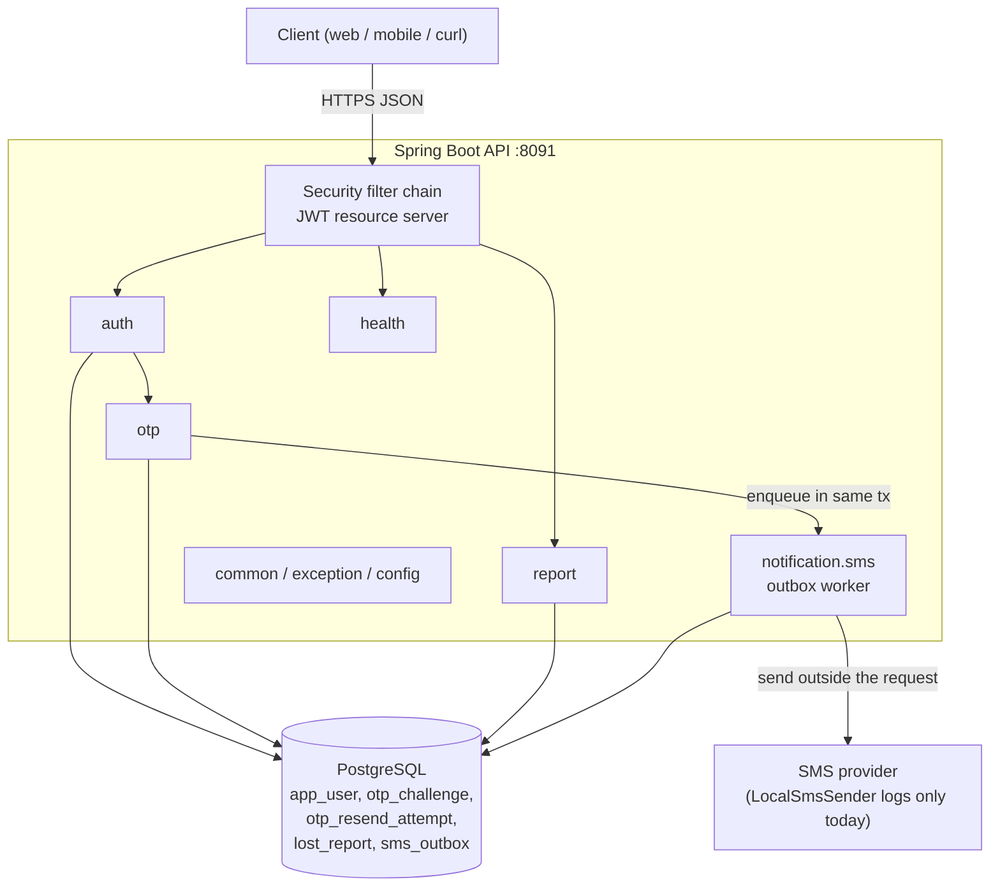

# 1. Architecture

## Decision: modular monolith

**Implemented.** Milaavo is one Spring Boot application with one PostgreSQL database, split into feature packages.

Why not microservices: there is one team, one deployable and no part of the system that needs independent scaling. A split would add network calls, distributed transactions, separate deployments and observability work without solving a real problem. Extract a module into a service only when one of these becomes true and measurable:

- it needs to scale independently (for example, SMS sending volume far beyond API traffic),
- a different team owns it and needs its own release cadence,
- its failures must be isolated from the API (for example, a provider SDK that leaks threads or memory).

The SMS outbox is the most likely first candidate, and its table-based design already makes that extraction easy: another process can claim from the same table.

## System context



## Modules

| Package | Responsibility | Key classes | Status |
|---|---|---|---|
| `auth` | Registration, login, mobile verification, resend OTP, JWT issuing | `AuthController`, `UserServiceImpl`, `JwtService`, `User` | Implemented |
| `otp` | Issue and verify OTP challenges for any purpose, HMAC hashing, resend limits | `OtpServiceImpl`, `OtpVerificationTransaction`, `OtpHasher`, `OtpChallenge`, `OtpResendAttempt` | Implemented |
| `notification.sms` | Outbox enqueue, claim, send, retry, recover; provider abstraction | `SmsOutboxService`, `SmsOutboxWorker`, `SmsOutboxClaimService`, `SmsOutboxProcessor`, `SmsOutboxRecoveryService`, `SmsSender` | Implemented, with gaps (see [05](05-sms-outbox.md)) |
| `report` | Lost-item report CRUD and pagination | `ReportController`, `ReportServiceImpl`, `LostReport` | Implemented, no ownership (Gap G-06) |
| `config` | Security filter chain, JWT encoder/decoder, password encoder, JSON 401/403 | `SecurityConfig`, `JwtConfig`, `PasswordConfig`, `ApiSecurityErrorHandler` | Implemented |
| `exception` | Map exceptions to a stable error body | `GlobalExceptionHandler` | Implemented |
| `common` | Shared response types | `ApiErrorResponse` | Implemented |
| `health` | Liveness endpoint | `HealthController` (`/api/health`) | Implemented. No readiness check (Proposed) |

`otp` is intentionally separate from `auth`: `OtpPurpose` already has `PASSWORD_RESET` and `CHANGE_MOBILE`, so the same issue/verify flow can serve future features without copying it.

## Request flow (layering)

```
Controller  →  Service (use case + @Transactional)  →  Repository (JPA / native SQL)  →  PostgreSQL
   │                 │
 DTO + @Valid     domain rules, exceptions
```

Rules the code follows today:

- Controllers depend on service interfaces (`UserService`, `ReportService`), never on repositories.
- Services own transaction boundaries. Repositories never call the network.
- DTOs are separate from JPA entities (`RegisterResponse`, `CreateReportResponse` and so on). Entities are never serialized directly.
- External providers sit behind a small interface (`SmsSender`), so a real provider can be added as another bean without touching domain code.
- Errors are thrown as typed exceptions and mapped in one place (`GlobalExceptionHandler`).

Rules to keep as the code grows (**Proposed**):

- Cross-module calls go through a service interface (`auth` → `OtpService`), not another module's repository. Today `UserServiceImpl` uses `OtpResendAttemptRepository` directly. Moving the resend-limit check into `OtpService` would keep the rule clean.
- `common` holds only truly shared types. It should not turn into a place for everything.
- Use constructor injection everywhere. `ReportController` and `ReportServiceImpl` still use field `@Autowired`, which makes them harder to test and hides dependencies.

## Background processing

Two `@Scheduled` jobs run inside the API process (`@EnableScheduling` on `MilaavoApplication`):

| Job | Interval | Work |
|---|---|---|
| `SmsOutboxWorker.processPendingMessages` | `app.sms-outbox.poll-delay-ms` (5 s, fixed delay) | Claim ≤ 50 due rows, send each |
| `SmsOutboxWorker.recoverStaleMessages` | `app.sms-outbox.recovery-delay-ms` (30 s, fixed delay) | Reset `PROCESSING` rows older than 2 min |

Running several app instances is safe for claiming, because `FOR UPDATE SKIP LOCKED` stops two instances from claiming the same row. The remaining multi-instance risks are covered in [05-sms-outbox.md](05-sms-outbox.md).

## Planned modules

The product scope (found reports, matching, claims, messaging, AI) is in [requirements.md](../product/requirements.md#6-architecture-additions). In short: `report` becomes `item` (LOST and FOUND), and new `matching`, `claim`, `message` and generic `job` modules are added inside the monolith. A separate Python **AI service** is the first justified split, because it uses a different runtime and has very different resource needs.

## Scale-up path (Proposed, in order)

1. Add metrics and alerts first ([07](07-observability-operations.md)). You cannot scale what you cannot see.
2. Tune the DB pool, add the right outbox index, and add retention for `sms_outbox` and `otp_*` tables.
3. Run 2+ stateless API instances behind a load balancer. JWTs are stateless, so no sticky sessions are needed.
4. Add rate limiting at the edge (per IP and per phone number) before traffic grows. SMS cost is the main abuse vector.
5. Use a read replica for report listing only if reads dominate and the replica lag is acceptable.
6. Move the SMS worker into its own deployment, reading the same outbox table, when sending load or provider problems start to affect API latency.
7. Introduce a message broker (Kafka, SQS) only when there are several consumers of the same events or the table-polling rate becomes a database bottleneck.
