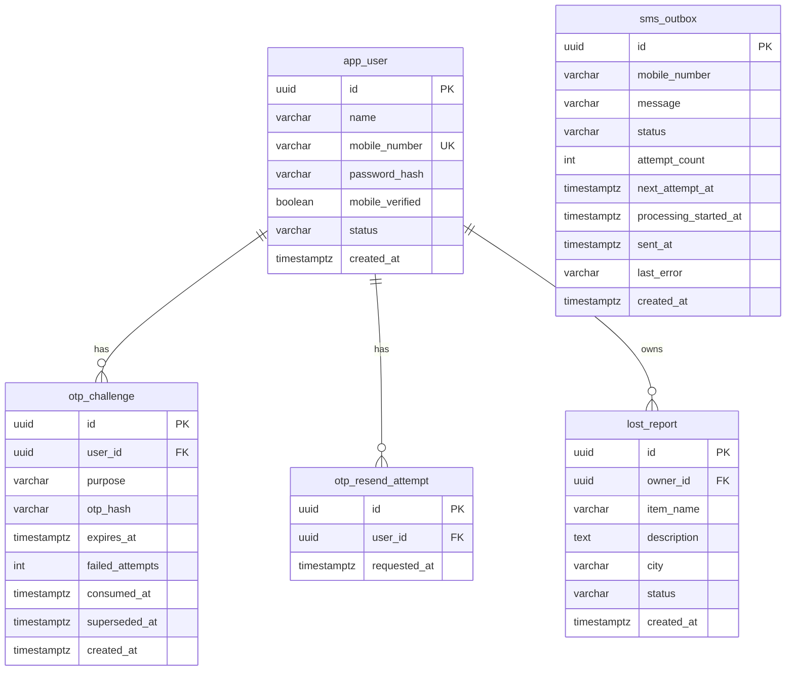

# 2. Data model and persistence

Source of truth: Liquibase changesets in `src/main/resources/db/changelog/changes/`. Hibernate runs with `ddl-auto: validate`, so the app refuses to start if entities and schema disagree.

## Entity relationships

`sms_outbox` deliberately has no foreign key to `app_user`. It is a delivery queue, and a message must still be sendable (or auditable) after unrelated user changes.

Every `lost_report` row belongs to one user through `owner_id` (added in changeset 008, G-06 fix).

## Tables

### `app_user` (changeset 002)

| Column | Type | Constraint | Notes |
|---|---|---|---|
| `id` | UUID | PK | Generated by Hibernate (`GenerationType.UUID`) |
| `name` | VARCHAR(100) | NOT NULL | |
| `mobile_number` | VARCHAR(20) | NOT NULL, UNIQUE `uk_app_user_mobile_number` | Only trimmed before saving (Gap G-14) |
| `password_hash` | VARCHAR(255) | NOT NULL | BCrypt, cost 12 |
| `mobile_verified` | BOOLEAN | NOT NULL, default false | |
| `status` | VARCHAR(20) | NOT NULL, default `PENDING_VERIFICATION` | `PENDING_VERIFICATION`, `ACTIVE`, `DISABLED`. No CHECK constraint |
| `created_at` | TIMESTAMPTZ | NOT NULL | Set in `@PrePersist` |

`mobile_verified` and `status = ACTIVE` always change together today. Keeping both is redundant, but it leaves room for a future state such as "verified but disabled".

### `otp_challenge` (changeset 003)

| Column | Type | Constraint | Notes |
|---|---|---|---|
| `id` | UUID | PK | Returned to the client as `challengeId` |
| `user_id` | UUID | NOT NULL, FK → `app_user` | |
| `purpose` | VARCHAR(30) | NOT NULL | `MOBILE_VERIFICATION`, `PASSWORD_RESET`, `CHANGE_MOBILE` |
| `otp_hash` | VARCHAR(255) | NOT NULL | Base64 HMAC-SHA256 of `userId:purpose:otp`. The raw OTP is never stored here |
| `expires_at` | TIMESTAMPTZ | NOT NULL | Issue time + 5 minutes |
| `failed_attempts` | INTEGER | NOT NULL, default 0 | Locks out at 5 |
| `consumed_at` | TIMESTAMPTZ | nullable | Set only on successful verification |
| `superseded_at` | TIMESTAMPTZ | nullable | Set when a newer OTP replaces this one (changeset 009). Before this, `consumed_at` was used for both meanings |
| `created_at` | TIMESTAMPTZ | NOT NULL | |

Index: `idx_otp_challenge_user_created (user_id, created_at)`.

The lookup query is `WHERE id = ? AND user_id = ? AND purpose = ?`, which uses the primary key. The supersede query is `WHERE user_id = ? AND purpose = ? AND consumed_at IS NULL AND superseded_at IS NULL AND expires_at > ?`, which uses the `user_id` prefix of the index.

### `otp_resend_attempt` (changeset 004)

| Column | Type | Constraint |
|---|---|---|
| `id` | UUID | PK, default `gen_random_uuid()` |
| `user_id` | UUID | NOT NULL, FK → `app_user` |
| `requested_at` | TIMESTAMPTZ | NOT NULL, default now |

Index: `idx_otp_resend_attempt_user_requested (user_id, requested_at)`. It serves both `MAX(requested_at)` (cooldown) and `COUNT(*) WHERE requested_at > ?` (window).

### `sms_outbox` (changesets 006, 007)

| Column | Type | Constraint | Notes |
|---|---|---|---|
| `id` | UUID | PK, default `gen_random_uuid()` | |
| `mobile_number` | VARCHAR(20) | NOT NULL | |
| `message` | VARCHAR(1000) | NOT NULL | **Contains the plaintext OTP** (Gap G-01) |
| `status` | VARCHAR(20) | NOT NULL, default `PENDING` | `PENDING`, `PROCESSING`, `SENT`, `FAILED`. No CHECK constraint |
| `attempt_count` | INT | NOT NULL, default 0 | Incremented when a send starts, inside the send transaction |
| `next_attempt_at` | TIMESTAMPTZ | NOT NULL | Earliest time the row can be claimed |
| `processing_started_at` | TIMESTAMPTZ | nullable | Set on claim, cleared on outcome. Used by recovery |
| `sent_at` | TIMESTAMPTZ | nullable | |
| `last_error` | VARCHAR(500) | nullable | Provider exception message, truncated |
| `created_at` | TIMESTAMPTZ | NOT NULL, default now | |

Index: `idx_sms_outbox_status_created_at (status, created_at)`.

### `lost_report` (changesets 001, 008)

| Column | Type | Constraint | Notes |
|---|---|---|---|
| `id` | UUID | PK | |
| `owner_id` | UUID | NOT NULL, FK `fk_lost_report_owner` → `app_user` | Set from the logged-in user on create. `updatable = false` in the entity, so it never changes |
| `item_name` | VARCHAR(200) | NOT NULL | DTO: `@Size(max = 200)` |
| `description` | TEXT | NOT NULL | No DB limit. DTO: `@Size(max = 2000)` |
| `city` | VARCHAR(100) | NOT NULL | DTO: `@Size(max = 100)` |
| `status` | VARCHAR(30) | NOT NULL | Always `REPORTED` today. Plain string, not an enum |
| `created_at` | TIMESTAMPTZ | NOT NULL | `@CreationTimestamp` |

Index: `idx_lost_report_owner_created (owner_id, created_at)`. It serves the "my reports, newest first" list (`WHERE owner_id = ? ORDER BY created_at DESC`). PostgreSQL can read a B-tree index backwards, so the `DESC` sort doesn't need a separate index.

> Changeset 008 deletes the existing `lost_report` rows before adding the `NOT NULL` column. That's fine for local test data only. With real data, use **expand → migrate → contract**: add the column as nullable, fill it in, then make it `NOT NULL` in a later release.

> Changeset numbering skips `005`. That is harmless, because Liquibase tracks changesets by id/author/file, not by number. Do not reuse 005 later, to avoid confusion.

## Proposed schema changes

Each one is a new changeset. Never edit an applied changeset, because Liquibase checksums will fail.

| # | Change | Why |
|---|---|---|
| ~~P-1~~ | ~~`lost_report.owner_id` + index~~ | ✅ Done in changeset 008 (G-06) |
| P-2 | `lost_report.updated_at TIMESTAMPTZ` and `version BIGINT` (`@Version`) | Audit trail and optimistic locking on concurrent PUTs |
| P-3 | Partial index `CREATE INDEX idx_sms_outbox_due ON sms_outbox (next_attempt_at) WHERE status = 'PENDING'` | Matches the claim query. The existing `(status, created_at)` index cannot filter on `next_attempt_at`. Verify with `EXPLAIN ANALYZE` on realistic data first |
| P-4 | `sms_outbox.claim_token UUID` (or `version BIGINT`) | Prevents a stale worker from overwriting a reclaimed row (G-03) |
| P-5 | `sms_outbox.expires_at TIMESTAMPTZ` | Stop retrying OTP messages after the OTP itself has expired (G-17) |
| P-6 | `CHECK (status IN (...))` on `app_user`, `sms_outbox`, `lost_report` | The database should enforce invariants even if a bug or manual SQL writes a bad value |
| P-7 | Retention job: delete or redact `sms_outbox.message` once `SENT`/`FAILED`, purge old `otp_challenge` and `otp_resend_attempt` rows | Limits personal data and table growth (G-01, G-16) |

## Persistence rules

- **All schema changes go through Liquibase.** No manual DDL in any shared environment.
- **Invariants that must hold under concurrency belong in the database**: unique constraints, foreign keys, CHECK constraints. Application checks such as `existsByMobileNumber` are only there for friendly error messages.
- **Store time as `TIMESTAMPTZ` and `Instant`, in UTC.** Convert to a display timezone only at the edge.
- **Index from real query patterns** and confirm with `EXPLAIN (ANALYZE, BUFFERS)` before and after.
- **Plan retention before volume arrives.** `sms_outbox`, `otp_challenge` and `otp_resend_attempt` are append-heavy and only useful for a short time.
- **Bulk `@Modifying` updates skip the persistence context.** Entities already loaded in the same transaction keep stale values. Today's bulk updates (`invalidateActiveChallenges`, `recoverStaleProcessingMessages`) run before related entities are loaded, so they are safe. Keep it that way, or use `clearAutomatically = true`.
