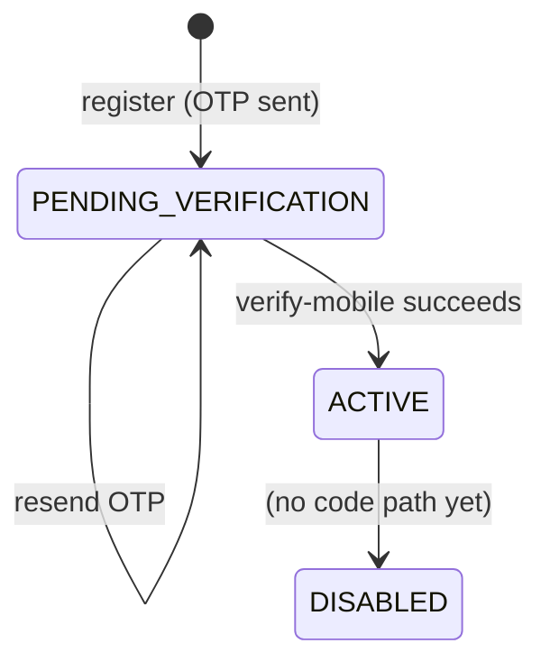
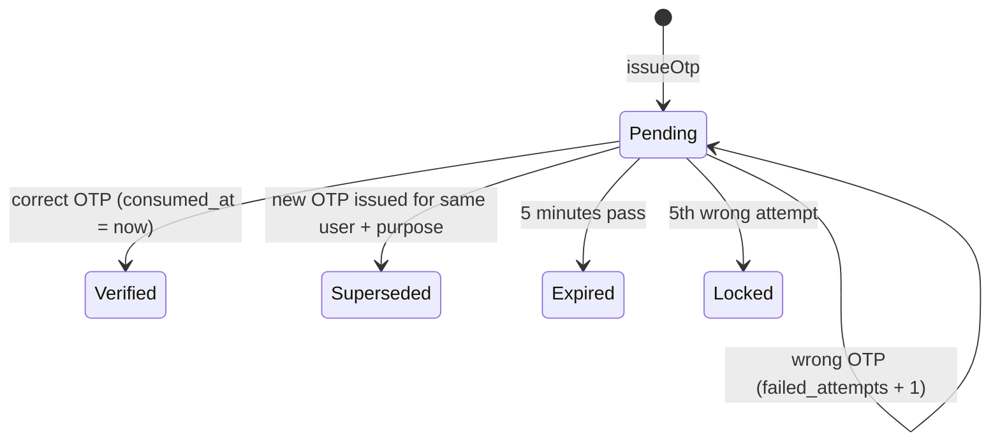

# 4. Authentication, OTP and security

## User lifecycle

Login is allowed only when `status = ACTIVE` and `mobile_verified = true`.

## OTP challenge lifecycle (Implemented)

A challenge has no `status` column. Its state is derived from its columns:

| Derived state | Condition |
|---|---|
| Pending | `consumed_at IS NULL AND now < expires_at AND failed_attempts < 5` |
| Verified | `consumed_at` set by a successful verification |
| Superseded | `consumed_at` set by `invalidateActiveChallenges` when a new OTP is issued |
| Expired | `now ≥ expires_at` |
| Locked | `failed_attempts ≥ 5` |

Verified and Superseded look the same in the database, so a superseded OTP is reported as "OTP has already been used" (G-22). Adding a `status` or `superseded_at` column would make the two distinguishable for both support and metrics.

### Issue (`OtpServiceImpl.issueOtp`)

1. Load the user.
2. Supersede open challenges for the same user and purpose (bulk update `consumed_at = now`).
3. Generate a 6-digit code with `SecureRandom.nextInt(1_000_000)`, zero-padded.
4. Store `HMAC-SHA256(key, "userId:purpose:otp")`, Base64-encoded.
5. Set `expires_at = now + 5 min`.
6. Enqueue the SMS in `sms_outbox` **in the same transaction**. Either the user, the challenge and the SMS all commit, or none do.

### Verify (`OtpVerificationTransaction.verify`)

Runs in `REQUIRES_NEW`, separate from the caller's transaction:

1. `SELECT … FOR UPDATE` on the challenge (`id`, `user_id` and `purpose` must all match). This serializes concurrent verifications of the same challenge.
2. Not found → `CHALLENGE_NOT_FOUND`. Consumed → `ALREADY_USED`. Expired → `EXPIRED`. `failed_attempts ≥ 5` → `MAX_ATTEMPTS_EXCEEDED`.
3. Hash mismatch → `failed_attempts + 1`, commit, `INVALID`.
4. Match → `consumed_at = now`, commit, `VERIFIED`.

**Why `REQUIRES_NEW`:** the caller throws `InvalidOtpException` on failure, which would roll back its transaction. If the failed-attempt counter were in the same transaction, it would be rolled back too, and brute-force protection would never count anything. The separate transaction commits the counter whatever the caller does.

Trade-offs of this choice:

- The OTP is consumed in its own commit **before** the user is activated in the outer commit. If the outer commit fails, the OTP is spent but the user is still `PENDING_VERIFICATION`. That is recoverable: the user requests a resend.
- `REQUIRES_NEW` suspends the outer transaction and takes a **second pool connection** while the first is still held. Under heavy concurrent verification this can exhaust the Hikari pool. The pool would need to allow 2 connections per in-flight verify (G-20).

Concurrency: two requests with the same correct OTP both reach `FOR UPDATE`. The first commits `consumed_at`, and the second then reads it and gets `ALREADY_USED`. Exactly one verification succeeds.

### Resend (`UserServiceImpl.resendVerificationOtp`)

1. `SELECT … FOR UPDATE` on `app_user`, which serializes resends for one user. Without the lock, two parallel requests could both pass the cooldown check (check-then-act race).
2. Reject if the user is already active.
3. Cooldown: `MAX(requested_at) + 60 s > now` → 429.
4. Window: `COUNT(requested_at > now − 15 min) ≥ 3` → 429.
5. Insert a resend attempt, then issue a new OTP (which supersedes the old one).

### OTP security properties

| Property | Status | How |
|---|---|---|
| Unpredictable code | Implemented | `SecureRandom` |
| Not stored in plaintext in `otp_challenge` | Implemented | Keyed HMAC. A plain SHA-256 of a 6-digit code can be brute-forced offline in milliseconds. HMAC needs the server key |
| Bound to user and purpose | Implemented | Both are inside the HMAC input and the lookup query |
| Constant-time comparison | Implemented | `MessageDigest.isEqual` |
| Short validity | Implemented | 5 minutes (hard-coded, G-18) |
| Attempt limit | Implemented | 5 per challenge, counted in a separate transaction |
| One-time use | Implemented | Row lock + `consumed_at` |
| Only the latest OTP works | Implemented | Supersede on issue |
| Resend throttling | Implemented | Per user: 60 s cooldown, 3 per 15 min |
| **OTP not stored in plaintext anywhere** | **Gap G-01** | The SMS text with the code sits in `sms_outbox.message` forever. Anyone with read access to the database can log in as a pending user within the 5-minute window |
| Per-IP / per-number-prefix / global SMS limits | **Gap G-15** | `register` has no limit at all, so a script can register many numbers and trigger SMS (toll fraud / SMS pumping) |
| Attempt limit across challenges | **Gap** | 5 tries per challenge × (1 + 3 resends) = 20 guesses per 15 minutes per user. Out of 10⁶ codes that is low risk, but monitor it |
| OTP never logged | Partly | `LocalSmsSender` logs the full message. Acceptable for `local` only. A real sender must never log message bodies |

## Passwords

- BCrypt, cost 12 (`PasswordConfig`).
- Length 12–72. BCrypt ignores input after 72 bytes, so the upper limit avoids a silent truncation surprise. Multi-byte characters can still exceed 72 bytes inside 72 characters.
- `@ToString.Exclude` keeps passwords out of Lombok `toString` and logs.

## JWT

**Implemented** (`JwtService`, `JwtConfig`, `SecurityConfig`):

| Aspect | Value |
|---|---|
| Algorithm | HS256 (symmetric). The decoder is pinned to HS256, so `alg: none` or switching algorithms is rejected |
| Key | `JWT_SECRET`, Base64, ≥ 32 bytes, checked at startup |
| Claims | `iss=milaavo`, `sub=<userId>`, `iat`, `exp` |
| Lifetime | 15 minutes, no refresh token |
| Validation | Signature and `exp`/`nbf` (Spring default timestamp validator, 60 s clock skew) |
| Session | `STATELESS`, CSRF disabled (correct for bearer tokens sent in a header, not cookies) |

Gaps and proposals:

- **G-13: issuer not validated.** The decoder does not check `iss`. Add `JwtValidators.createDefaultWithIssuer("milaavo")`, and an `aud` claim if more than one service ever shares a key.
- **No revocation.** Logout, password change or a disabled account do not invalidate issued tokens for up to 15 minutes. That is acceptable at this lifetime. If it ever matters: add a `token_version` on the user and put it in a claim, or keep a short deny-list.
- **No authorities.** Every authenticated user has the same rights. Add roles (`ROLE_USER`, `ROLE_ADMIN`) when admin features appear.
- **Refresh tokens** (Proposed, only if the product needs long sessions): opaque, stored hashed, rotated on every use, with reuse detection that revokes the whole token family.
- **Key rotation.** Moving to RS256/ES256 with a `kid` header lets keys rotate without downtime and lets other services verify without the signing secret.

## Authorization

- **G-06: broken object-level authorization on reports.** No owner, no checks. This is OWASP API Security #1. Fix: add `owner_id` (P-1), set it from `jwt.sub` on create, and filter by owner on update and delete. Return **404, not 403**, for someone else's report, so the API does not confirm that the id exists.
- Pass the authenticated user id into services explicitly (for example `@AuthenticationPrincipal Jwt jwt` → `UUID.fromString(jwt.getSubject())`). Never take it from the request body.

## Other security review items

| Item | Status |
|---|---|
| Secrets in env vars, `.env` gitignored | Implemented |
| Separate keys for JWT and OTP HMAC | Implemented (two variables). Document that they must differ |
| Security logging at `TRACE` (G-12) | Gap. It logs full filter-chain detail, including headers. Use `INFO` by default and `DEBUG` locally when needed |
| CORS | Not configured. Fine for non-browser clients. Add an explicit allow-list before a web front end |
| Security headers | Spring Security defaults (HSTS on HTTPS, `X-Content-Type-Options`, frame options) |
| TLS | Expected to terminate at the load balancer or ingress (Proposed, [08](08-configuration-deployment.md)) |
| Mobile number normalization (G-14) | Only `trim()`. `+91 98…`, `098…` and `98…` become different accounts. Normalize to E.164 (for example with libphonenumber) before the uniqueness check |
| Account enumeration | Register 409 reveals existing numbers (see [03](03-api.md)) |
| Unknown `userId` returns 500 (G-07) | Also lets anyone probe whether a user id exists (500 versus 409/429) |
