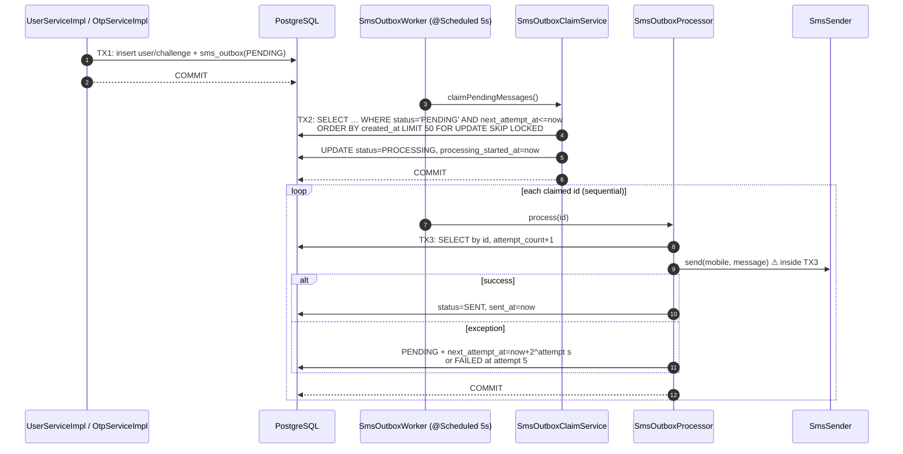

# 5. SMS outbox

## Why an outbox

The OTP challenge and the SMS must agree. Two naive designs fail:

- **Send inside the request transaction.** The SMS goes out, then the commit fails, so the user gets a code that does not exist. A slow provider also holds a DB connection and the user's request for the whole network wait.
- **Send after commit** (`@TransactionalEventListener(AFTER_COMMIT)`). The commit succeeds, then the app crashes or the provider fails, so the SMS is lost with no record and no retry.

The transactional outbox writes the "send this SMS" intent in the **same transaction** as the challenge. A separate worker delivers it with retries. That guarantees the message is never lost, but delivery is **at-least-once**, so duplicates are possible.

> `OtpSmsEvent` and `OtpSmsEventListener` (the after-commit approach) are still in the code but nothing publishes the event. The `// TODO` in `OtpServiceImpl.issueOtp` is also out of date. Remove both (G-10).

## Current implementation



Recovery (`@Scheduled` every 30 s): `UPDATE … SET status='PENDING', next_attempt_at=now, processing_started_at=NULL WHERE status='PROCESSING' AND processing_started_at < now − 2 min`.

### What is already right

- **Atomic enqueue.** The outbox row commits with the business data.
- **`FOR UPDATE SKIP LOCKED` in native SQL**, with no JPA `@Lock` on the native query. An earlier version had both, which caused the Hibernate exception. The current `SmsOutboxRepository` has no `@Lock` on `claimPendingMessages`, so that issue is resolved. Multiple workers or instances never claim the same row at the same time.
- **The claim commits before sending**, so the claim lock is short.
- **Separate beans for claim and process**, so `@Transactional` goes through Spring proxies. Self-invocation would have silently skipped them.
- **Per-message try/catch in the worker.** One bad message does not stop the batch.
- **Error text truncated** to fit `last_error VARCHAR(500)`.

### Retry schedule (current, since G-17 on 25 Oct 2026)

Capped exponential backoff with equal jitter: `wait = min(retry-max-delay, retry-base-delay × 2^(attempt-1))`, then a random value between `wait/2` and `wait`. Defaults: base `5s`, max `60s`.

| Attempt that failed | Exponential | Actual wait |
|---|---|---|
| 1 | 5 s | 2.5 – 5 s |
| 2 | 10 s | 5 – 10 s |
| 3 | 20 s | 10 – 20 s |
| 4 | 40 s | 20 – 40 s |
| 5 | → `FAILED` | |

About 75 s at most in total, so a one-minute provider outage no longer fails every OTP. Jitter spreads retries out, so they don't all hit the provider at once (thundering herd). Each wait is effectively rounded up to the next poll (every 5 s).

**Expiry:** every OTP message has `expires_at` = the OTP's expiry. Expired rows are never claimed, the recovery job marks expired `PENDING` rows `FAILED` ("Expired before delivery"), and `recordFailure` fails a message straight away if its next retry would land after expiry.

Before G-17 the waits were 2, 4, 8, 16 s with no jitter, finishing in about 30 s.

> **Update 24 Oct 2026 (G-02 done):** the provider call now happens with no transaction open. `SmsOutboxProcessor` calls `SmsOutboxStateService.loadForSending`, then `smsSender.send`, then `markSent` or `recordFailure`, each a short transaction. The sequence diagram above shows the old flow. F1 (slow provider holding connections) is fixed; F2 and F7 remain, because at-least-once delivery can't be avoided.

## Failure modes

| # | Scenario | What happens today | Result | Gap |
|---|---|---|---|---|
| F1 | Provider is slow | DB connection and transaction stay open for the whole send. 50 slow sends in sequence block the single scheduler thread | Pool pressure. Recovery also waits, because it shares the scheduler thread | G-02, G-21 |
| F2 | Send succeeds, then the commit fails or the app crashes | TX3 rolls back, so the row stays `PROCESSING` (TX2 committed it), with no attempt counted | Recovered after 2 min and **sent again** | G-02 |
| F3 | Send takes longer than the lease (or the instance freezes during a GC pause) | **Fixed for state (G-03, G-04):** each claim gets a new `claim_token`; outcome updates lock the row and require the token, so A's late update matches nothing and logs "Lease lost". Verified with two instances on 25 Oct 2026 | Duplicate SMS still possible (at-least-once), but no lost update | ~~G-03~~ ✅ ~~G-04~~ ✅ |
| F4 | Message reliably crashes the processor (poison message) | **Fixed (G-05):** the attempt is counted at claim, and recovery fails the row at the limit | Stops after 5 attempts | ~~G-05~~ ✅ |
| F5 | Provider outage | **Improved (G-17):** retries now span about 75 s with jitter, instead of 30 s | Survives short outages; longer ones still need users to resend | ~~G-17~~ ✅ |
| F6 | Retries continue past OTP expiry | **Fixed (G-17):** `expires_at` stops claims and retries after the OTP expires | No late, useless SMS | ~~G-17~~ ✅ |
| F7 | Provider accepts, but the client times out | Treated as a failure and retried | Duplicate SMS | G-02 |
| F8 | Database is down | Claim throws, the worker logs and retries next tick | Correct: nothing is lost | |

**Key interview point:** a database transaction cannot include the SMS provider. No arrangement of `@Transactional` gives exactly-once delivery. The real choices are at-most-once (may lose) or at-least-once (may duplicate) plus idempotency or deduplication where the provider supports it. For OTP, at-least-once is correct: a duplicate SMS is a small annoyance, while a lost one blocks sign-up.

## Target design (Proposed)

```mermaid
sequenceDiagram
    autonumber
    participant W as Worker (non-transactional orchestrator)
    participant St as SmsOutboxStateService (short @Transactional methods)
    participant DB as PostgreSQL
    participant S as SmsSender (finite timeout)

    W->>St: claim(batch, leaseDuration)
    St->>DB: SELECT … FOR UPDATE SKIP LOCKED<br/>SET PROCESSING, claim_token=uuid, lease_until=now+lease, attempt_count+1
    St-->>W: [(id, claim_token)]  (committed)
    loop each message
        W->>S: send(…)  — no transaction open
        alt accepted
            W->>St: markSent(id, token, providerRef)
        else retryable
            W->>St: markRetry(id, token, error)  → PENDING, backoff+jitter
        else permanent / limit / OTP expired
            W->>St: markFailed(id, token, error)
        end
        St->>DB: UPDATE … WHERE id=? AND claim_token=? AND status='PROCESSING'
        Note over St,DB: 0 rows updated ⇒ lease was lost; log it, do not overwrite
    end
```

### Changes, in order

1. **Move the provider call out of the transaction.** Split `SmsOutboxProcessor` into a non-transactional orchestrator and a `SmsOutboxStateService` bean with short `@Transactional` methods. Call it through the injected bean, not `this.`, so the proxy applies. Fixes F1, and makes F2 and F7 explicit.
2. **Count the attempt at claim time**, in TX2. Then a crash still counts, and poison messages reach `FAILED` (F4). Document that `attempt_count` means "attempts started", not "failures confirmed".
3. **Claim token + conditional outcome updates** (P-4). `UPDATE … WHERE id = :id AND claim_token = :token`. A stale worker updates 0 rows and backs off (F3). An `@Version` column is an alternative.
4. **Configurable lease** (`app.sms-outbox.lease-seconds`, default for example 60 s). Must be much larger than the provider timeout. Replace the hard-coded 2 minutes in `SmsOutboxRecoveryService` (G-04). Recovery should also count recoveries and fail a row after N.
5. **Provider timeout** (connect and read) in the real `SmsSender`, for example 5 s, well below the lease.
6. **Message expiry** (P-5). Store `expires_at` (for OTP, the challenge expiry). The claim query skips expired rows and marks them `FAILED` with reason `EXPIRED` (F6).
7. **Backoff with jitter and a cap**, for example `min(cap, base × 2^n) × random(0.5, 1.0)`. For OTP the cap is set by expiry. Generic notifications could use longer caps such as 1 min, 5 min or 30 min (F5).
8. **Classify errors.** Retryable (timeouts, 5xx, 429) versus permanent (invalid number, blocked). Permanent errors go straight to `FAILED`.
9. **Provider idempotency.** If the provider accepts a client reference, send the outbox `id` as that reference. The provider then deduplicates retries (F2, F7).
10. **Do not store the plaintext OTP** (G-01). Options, from best to simplest:
    - Use the provider's OTP/template API and pass the code only at send time. The code then has to come from somewhere, so encrypt it (next option).
    - Store `template_id` plus encrypted params (AES-GCM with a key from the secret store), decrypt only at send time, and null the column after `SENT`/`FAILED`.
    - At minimum, a retention job that blanks `message` after completion and purges old rows (P-7).
11. **Separate scheduler threads** (`spring.task.scheduling.pool.size: 2`) so recovery is never blocked by a long batch (G-21). Add graceful shutdown: stop claiming new work and let in-flight sends finish within the lease.
12. **Remove dead code**: `findTop50ByStatusAndNextAttemptAtLessThanEqualOrderByCreatedAtAsc`, `OtpSmsEvent`/`OtpSmsEventListener`, and the unused `SmsSender` and `ApplicationEventPublisher` fields in `OtpServiceImpl` (G-10).

### Target state transitions

| From | To | Condition |
|---|---|---|
| — | `PENDING` | Enqueued with the business transaction |
| `PENDING` | `PROCESSING` | Due (`next_attempt_at ≤ now`), not expired, claimed under `SKIP LOCKED`. Token and lease set, attempt counted |
| `PENDING` | `FAILED` | Expired before it could be sent |
| `PROCESSING` | `SENT` | Provider accepted. Token matches. `provider_ref` stored |
| `PROCESSING` | `PENDING` | Retryable error, attempts remain, not expired. Token matches |
| `PROCESSING` | `FAILED` | Permanent error, attempt limit reached, or expired. Token matches |
| `PROCESSING` | `PENDING` | Lease expired (recovery). Token cleared, so the old worker's update will match 0 rows |

## Verification scenarios

Run these by hand now and automate them later (Testcontainers + PostgreSQL):

| Scenario | How to cause it | Expected (target) |
|---|---|---|
| Happy path | Register | `PENDING → PROCESSING → SENT` within ~5 s, `sent_at` set |
| Retryable failure | `SmsSender` stub that throws | Attempt counted, `PENDING` with a future `next_attempt_at` |
| Retry limit | Always throw | `FAILED` after 5 attempts |
| Concurrent workers | Two app instances on one DB | No row is sent by both in the same lease |
| Crash after claim | Kill the app between claim and send | Recovered after the lease, attempt counted |
| Slow provider | `Thread.sleep` longer than the lease | Stale worker's outcome update matches 0 rows and is logged |
| Poison message | Throw `Error` / kill on one specific id | Reaches `FAILED` after N attempts |
| Expired OTP | Make the provider fail for longer than 5 min | Row becomes `FAILED` with reason expired, no late SMS |

Diagnostic SQL for these is in the [runbook](../runbook/sms-outbox.md).
