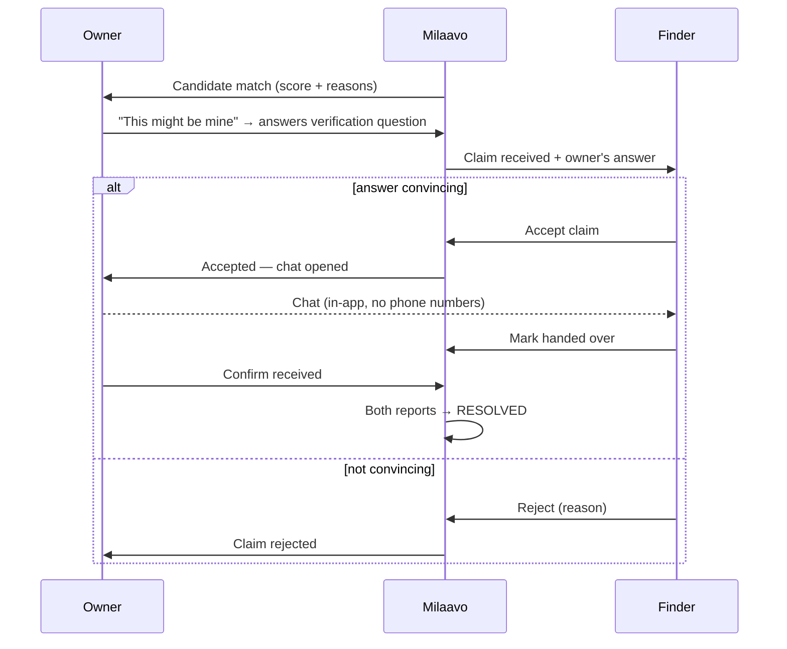
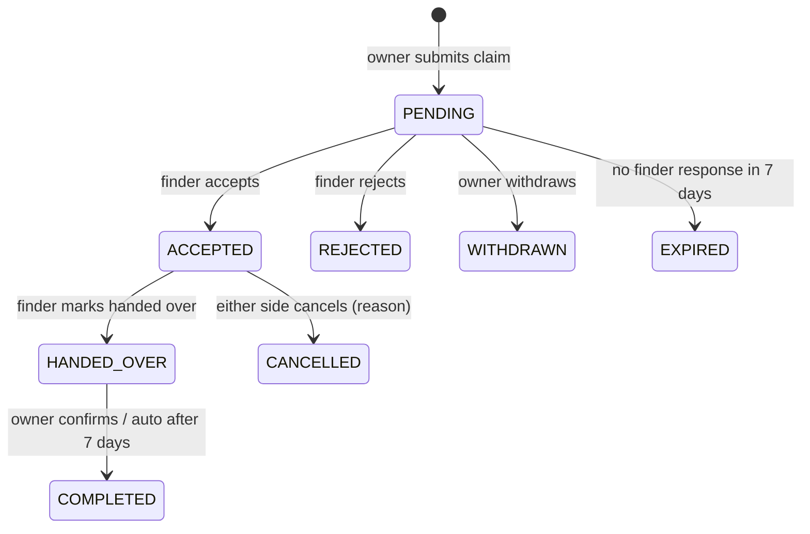
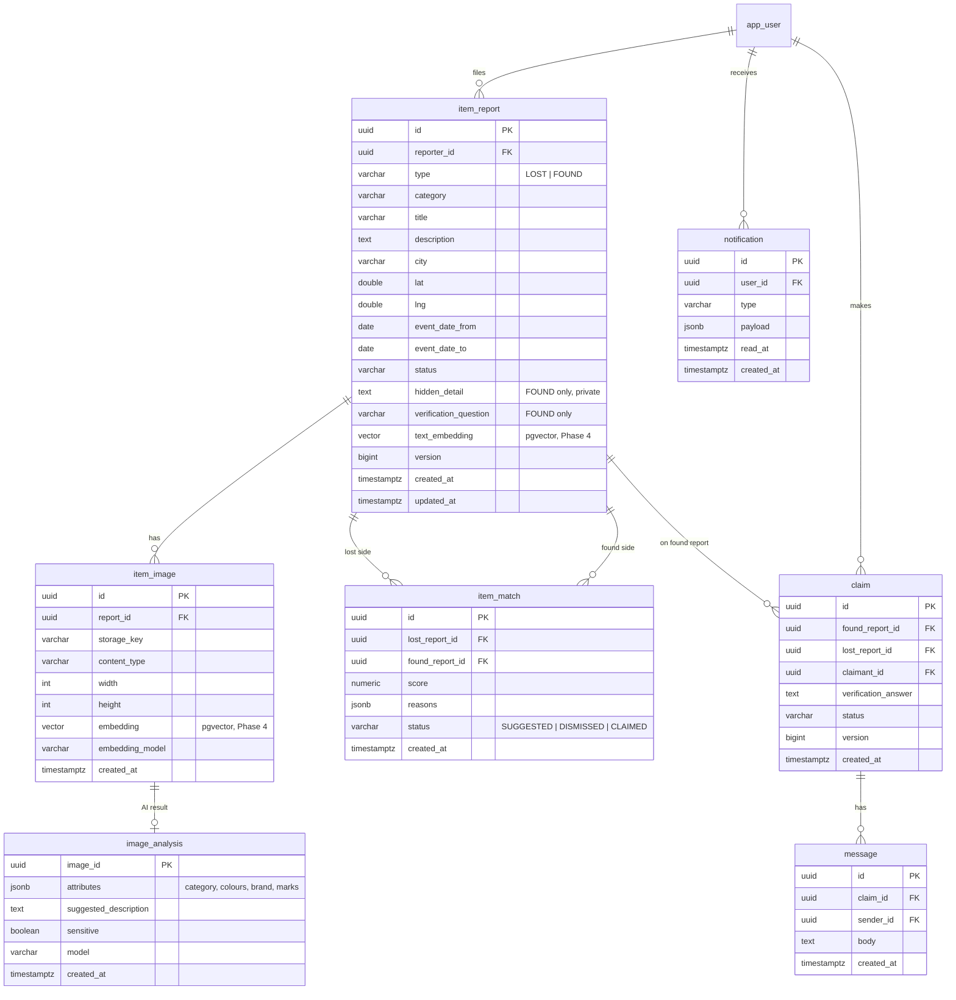
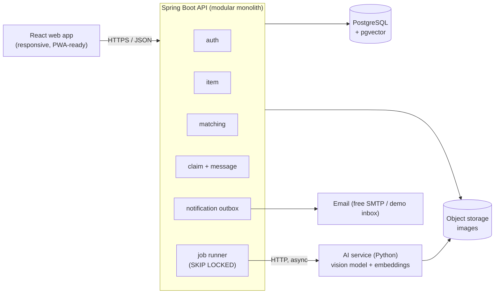

# Milaavo: product and technical requirements

*Version 0.1, 24 Oct 2026. Status: draft. Read with [vision.md](vision.md).*

Requirement ids are stable. Use them in commits, PRs and the [evidence log](../sde3/evidence-log.md). Priority: **M** = must have for the phase, **S** = should, **C** = could. **Status** shows what exists today.

---

## 1. Glossary

| Term | Meaning |
|---|---|
| **Item report** | A report of a lost item or a found item. One table with `type = LOST | FOUND` |
| **Owner** | The user who lost an item, who files a LOST report |
| **Finder** | The user who found an item, who files a FOUND report |
| **Match** | A suggested pairing of one LOST and one FOUND report, with a score and reasons |
| **Claim** | An owner's request to recover a FOUND item, including the answer to the verification question |
| **Hidden detail** | Something about the item that the finder keeps private and the owner must describe, for example "what is the wallpaper on the phone" or "what is written inside the wallet" |
| **Handover** | The physical return, confirmed by both sides |

## 2. Core user journeys

### J1: Finder reports a found item (phone browser)

1. Taps "I found something", takes or uploads 1–5 photos.
2. *(Phase 4)* AI pre-fills category, colour, brand and a description. The finder edits or accepts.
3. Picks the place on a map (or "use my location") and the date found.
4. Adds a **hidden detail** and a verification question, both shown only to the finder.
5. Chooses where the item is now: "with me", or a "handed to police station / office" free-text field.
6. Submits. The report is public in a **redacted** form: approximate area, no hidden detail.

### J2: Owner reports a lost item

1. Taps "I lost something". Category, description, optional photos (for example an old photo of the bag), approximate area and a date range.
2. Submits and immediately sees any existing candidate matches.
3. Gets an in-app notification (plus email in demo mode) when new candidate matches appear later.

### J3: Match → claim → handover

### J4: Browse and search

Anyone signed in can search public found reports by category, area and date, and open a redacted detail page. Lost reports are visible only to their owner and to the matching engine, so owners cannot be targeted by scammers who would otherwise read "lost iPhone" posts.

---

## 3. Functional requirements

### 3.1 Accounts and authentication: `FR-AUTH`

| Id | Requirement | Pri | Status |
|---|---|---|---|
| FR-AUTH-1 | Register with name, mobile number and password. Verify the mobile number with an OTP | M | **Implemented** |
| FR-AUTH-2 | Log in, get a short-lived access token | M | **Implemented** (JWT, 15 min) |
| FR-AUTH-3 | Resend OTP with cooldown and window limits | M | **Implemented** |
| FR-AUTH-4 | Session persists in the web app across reloads: refresh token in an `HttpOnly`, `Secure`, `SameSite=Strict` cookie, access token in memory | M | Proposed |
| FR-AUTH-5 | Log out (revoke the refresh token) | M | Proposed |
| FR-AUTH-6 | Forgot password via OTP (`OtpPurpose.PASSWORD_RESET` already exists) | S | Proposed |
| FR-AUTH-7 | Optional email on the profile, for demo-mode notifications | S | Proposed |
| FR-AUTH-8 | Roles: `USER`, `MODERATOR`, `ADMIN` | S | Proposed |
| FR-AUTH-9 | Delete my account and my data | S | Proposed |

### 3.2 Item reports: `FR-ITEM`

The current `lost_report` table becomes a general `item_report` (see §5).

| Id | Requirement | Pri | Status |
|---|---|---|---|
| FR-ITEM-1 | Create a LOST report: category, title, description, area, date or date range, optional photos | M | Partly (lost only, with owner; no category, location or photos yet) |
| FR-ITEM-2 | Create a FOUND report: as above, plus hidden detail, verification question and current custody | M | Proposed |
| FR-ITEM-3 | Every report has an owner (`reporter_id`). Only the reporter (or a moderator) can edit, close or delete it | M | **Implemented** for lost reports (G-06, column `owner_id`). Moderators come later |
| FR-ITEM-4 | Upload 1–5 images per report (JPEG/PNG/WebP, ≤ 5 MB each). Strip EXIF metadata, including GPS. Generate thumbnails | M | Proposed |
| FR-ITEM-5 | Location: a map pin stored as lat/lng, shown publicly only as an approximate area (rounded to about 500 m, or locality name), plus city | M | Proposed (city only today) |
| FR-ITEM-6 | Categories from a fixed list: phone, wallet, bag, keys, documents/ID, jewellery, electronics, pet, clothing, other | M | Proposed |
| FR-ITEM-7 | Status lifecycle: `OPEN → MATCHED → CLAIMED → RESOLVED`, plus `CLOSED` (withdrawn) and `EXPIRED` (no activity for 90 days, with a reminder first) | M | Proposed (`REPORTED` only) |
| FR-ITEM-8 | "My reports" list, newest first | M | Proposed |
| FR-ITEM-9 | Search public FOUND reports by category, city/area radius and date range, paginated | M | Proposed |
| FR-ITEM-10 | Documents/ID category: images are never public, only the category and area are shown | M | Proposed |
| FR-ITEM-11 | Report a listing as abusive or fake | S | Proposed |

### 3.3 Matching: `FR-MATCH`

| Id | Requirement | Pri | Status |
|---|---|---|---|
| FR-MATCH-1 | When a report is created or edited, find candidate opposite-type reports asynchronously (job/outbox, not in the request) | M | Proposed |
| FR-MATCH-2 | Candidate filter: same category; distance ≤ configurable radius (default 10 km); found date within [lost from − 1 day, lost to + 30 days]; both `OPEN`/`MATCHED` | M | Proposed |
| FR-MATCH-3 | Score = weighted sum of: text similarity, attribute agreement (colour, brand), distance, time gap, and *(Phase 4)* image and text embedding similarity. Weights in configuration | M | Proposed |
| FR-MATCH-4 | Store the top N (default 10) matches above a threshold, with a **reasons** breakdown per signal | M | Proposed |
| FR-MATCH-5 | The owner sees their matches ranked, with reasons. Can dismiss ("not mine") or claim | M | Proposed |
| FR-MATCH-6 | Notify the owner of new matches above a "high confidence" threshold. Notify at most once per pair | M | Proposed |
| FR-MATCH-7 | Dismissed pairs never come back. Feedback (dismiss or claim) is stored to tune weights later | S | Proposed |
| FR-MATCH-8 | Re-run matching for open reports nightly, to catch matches that improve as new data arrives | C | Proposed |
| FR-MATCH-9 | Matching works without AI (Phase 2). AI signals add to it but are never required | M | Proposed |

### 3.4 Claims, verification and handover: `FR-CLAIM`

| Id | Requirement | Pri | Status |
|---|---|---|---|
| FR-CLAIM-1 | An owner can claim a FOUND report from a match (or from search, linking their LOST report), answering the finder's verification question | M | Proposed |
| FR-CLAIM-2 | At most one open claim per (claimant, found report). At most 3 open claims per user, to limit fishing | M | Proposed |
| FR-CLAIM-3 | The finder accepts or rejects (with a reason). Reject is final for that claimant | M | Proposed |
| FR-CLAIM-4 | On accept, an in-app chat opens between the two users. Phone numbers are only shared if both press "share my number" | M | Proposed |
| FR-CLAIM-5 | Handover: the finder marks "handed over", the owner confirms "received", and both reports become `RESOLVED`. Auto-confirm after 7 days of no response (configurable) | M | Proposed |
| FR-CLAIM-6 | Claim state changes must be safe under concurrency: two claimants cannot both be accepted for one item (one accepted claim per found report, enforced by a DB constraint) | M | Proposed |
| FR-CLAIM-7 | Safety guidance shown before handover (meet in public, police station option) | S | Proposed |
| FR-CLAIM-8 | Either side can report the other. Moderators can see the claim history | S | Proposed |

Claim state machine:

### 3.5 Messaging: `FR-MSG`

| Id | Requirement | Pri | Status |
|---|---|---|---|
| FR-MSG-1 | Text chat per accepted claim, visible only to the two parties (and moderators on a report) | M | Proposed |
| FR-MSG-2 | Polling every few seconds is acceptable for v1. WebSocket/SSE is a later learning step | M / C | Proposed |
| FR-MSG-3 | Basic content safety: length limit, rate limit, phone-number pattern warning before consent | S | Proposed |

### 3.6 Notifications: `FR-NOTIF`

**Zero-cost decision:** no paid SMS provider. The `SmsSender` abstraction and the outbox stay (they are good engineering and good interview material), but delivery uses **demo channels**:

| Id | Requirement | Pri | Status |
|---|---|---|---|
| FR-NOTIF-1 | In-app notification centre (matches, claims, messages, status changes), stored in the DB | M | Proposed |
| FR-NOTIF-2 | Generalize the SMS outbox into a **notification outbox** with a `channel` column (`SMS`, `EMAIL`, `IN_APP`) and one sender per channel | M | Proposed (SMS outbox implemented) |
| FR-NOTIF-3 | OTP in the deployed demo: **email** through a free SMTP option, *or* a "demo inbox" page that shows the OTP to the person who just registered, enabled only with a `demo` flag and clearly labelled. Pick one in ADR-003 | M | Proposed |
| FR-NOTIF-4 | `LocalSmsSender` stays for local development. A real SMS provider can be added later as one new bean | M | Implemented (local only, G-09) |
| FR-NOTIF-5 | Users choose which events notify them by email | C | Proposed |

### 3.7 AI assistance: `FR-AI` (Phase 4)

| Id | Requirement | Pri | Status |
|---|---|---|---|
| FR-AI-1 | **Attribute extraction from photos:** from an uploaded image, suggest category, dominant colours, brand/model if visible, distinctive marks, and a one-sentence description. Shown as editable suggestions, never saved without the user's confirmation | M | Proposed |
| FR-AI-2 | **Image embeddings:** compute a vector per image and store it in PostgreSQL with `pgvector` | M | Proposed |
| FR-AI-3 | **Text embeddings** of title + description, for semantic similarity ("black leather purse" ≈ "dark wallet") | S | Proposed |
| FR-AI-4 | Matching uses vector cosine similarity (top-K by approximate nearest neighbour, then rule filters) as additional score signals with their own reasons | M | Proposed |
| FR-AI-5 | **Sensitive-content check:** flag images that look like ID documents, cards or faces, so they are kept private or blurred | S | Proposed |
| FR-AI-6 | AI runs **asynchronously** through a job queue. Report creation never waits on AI. Suggestions appear when ready (UI polls) | M | Proposed |
| FR-AI-7 | Provider-agnostic interfaces (`ImageAnalyzer`, `EmbeddingModel`). The default is self-hosted open-source models (zero cost). A hosted multimodal model API can be configured instead | M | Proposed |
| FR-AI-8 | Record the model name and version with every extraction and embedding, so items can be re-embedded when the model changes | M | Proposed |
| FR-AI-9 | Evaluation: a small labelled set of lost/found pairs (your own photos) to measure precision@5 before and after AI signals | S | Proposed |
| FR-AI-10 | If the AI is unavailable: reports are still accepted, matching falls back to rule signals, and jobs are retried with backoff | M | Proposed |

### 3.8 Moderation and admin: `FR-ADMIN` (Phase 5)

| Id | Requirement | Pri |
|---|---|---|
| FR-ADMIN-1 | Moderator queue of reported listings, users and messages | S |
| FR-ADMIN-2 | Hide a report, suspend a user (`UserStatus.DISABLED` exists already) | S |
| FR-ADMIN-3 | Audit log of moderator actions | S |
| FR-ADMIN-4 | Basic stats: reports per day, matches, completed returns | C |

---

## 4. Non-functional requirements

| Id | Area | Requirement |
|---|---|---|
| NFR-SEC-1 | Security | Object-level authorization on every report, claim, message and image. Return 404 for resources the user may not see |
| NFR-SEC-2 | Security | OWASP API Top 10 reviewed per phase. Rate limits on auth, OTP, report creation, claims and messages |
| NFR-SEC-3 | Security | Secrets only in environment variables or a secret store. TLS everywhere in the deployment |
| NFR-SEC-4 | Security | Uploaded files: validate type by content (magic bytes), not extension. Re-encode images. Size limits. Never serve them from the API origin with user-controlled content types |
| NFR-PRIV-1 | Privacy | Phone numbers and exact locations are never in public responses. EXIF is stripped. Hidden details are only visible to the finder |
| NFR-PRIV-2 | Privacy | Retention: resolved/closed reports and images purged after 180 days, OTP and outbox data per [07](../design/07-observability-operations.md#data-retention-proposed) |
| NFR-PERF-1 | Performance | API p95 < 300 ms for reads and < 500 ms for writes, excluding image upload, on the free-tier deployment at 10 concurrent users |
| NFR-PERF-2 | Performance | A match appears ≤ 2 min after a report is created (rule-based), and ≤ 10 min including AI on free hardware |
| NFR-AVAIL-1 | Availability | Best-effort single instance (free tier). Target: survive a restart with no data loss, and recover from a VM loss by rebuilding from infrastructure code + backup in < 1 h |
| NFR-COST-1 | Cost | **₹0 per month** running cost. Any paid service must be optional and disabled by default |
| NFR-OBS-1 | Observability | Structured logs with correlation id, metrics (Prometheus format), dashboards and alerts for the outbox, matching jobs, AI jobs and error rate |
| NFR-UX-1 | UX | Responsive from 360 px wide. Camera capture through `<input type="file" accept="image/*" capture>`. Works on recent Chrome, Safari and Firefox |
| NFR-A11Y-1 | Accessibility | WCAG 2.1 AA basics: labels, keyboard navigation, contrast, alt text from the AI description |
| NFR-MAINT-1 | Maintainability | Every architectural decision recorded as a short ADR in `docs/adr/`. CI must pass before merge |
| NFR-TEST-1 | Testing | Integration tests on real PostgreSQL (Testcontainers) for matching, claims and outbox concurrency |

---

## 5. Domain model changes (target)

Key constraints:

- `item_match`: `UNIQUE (lost_report_id, found_report_id)`, plus a check that the two reports have opposite types (enforced in the service, since a CHECK cannot look at other rows).
- `claim`: partial unique index `ON claim (found_report_id) WHERE status IN ('ACCEPTED','HANDED_OVER','COMPLETED')`, so only one successful claim per item (FR-CLAIM-6). Also `UNIQUE (found_report_id, claimant_id)`.
- `item_report`: index on `(type, category, status, event_date_from)`. Use the `earthdistance`/`cube` extension or PostGIS for radius queries (or a bounding-box prefilter on lat/lng). Add an HNSW index on the `pgvector` columns in Phase 4.
- Migration from `lost_report`: expand/contract. Create `item_report`, copy the rows as `type = LOST` (with the reporter unknown → assign to a seed admin, or truncate the dev data), switch the code, then drop `lost_report`.

---

## 6. Architecture additions

- **Job runner:** reuse the outbox pattern (claim with `SKIP LOCKED`, lease, retry) in a generic `job` table with `type` values `ANALYZE_IMAGE`, `EMBED_REPORT`, `MATCH_REPORT` and `SEND_NOTIFICATION`. One reliable mechanism to explain, built once and used everywhere. Fixing the outbox gaps G-02 to G-05 first pays off here.
- **AI service as a separate deployable** (Python, FastAPI). This is the first *justified* service split: a different runtime and ecosystem (PyTorch/ONNX models), very different resource use (CPU/RAM-heavy), and it can be scaled or turned off independently. A good interview example of "when a monolith should split".
- **Object storage** for images, behind a `FileStorage` interface (local filesystem in dev, S3-compatible in the cloud). Uploads go through the API, which validates, strips EXIF and re-encodes. Pre-signed upload URLs are a later optimization.
- **Search:** PostgreSQL full-text search plus `pg_trgm` for text, `pgvector` for embeddings. No Elasticsearch: one database to operate.

### Zero-cost AI options (choose in ADR-004)

| Need | Self-hosted, free | Notes |
|---|---|---|
| Image + text embeddings in one vector space | CLIP / SigLIP-family open models via `sentence-transformers` or ONNX Runtime | Runs on CPU. Lets a text description be compared with a photo |
| Attribute extraction / description | A small open vision-language model served by Ollama or llama.cpp | Slow on CPU (seconds to tens of seconds per image). Acceptable because the work is async |
| Hosted alternative (optional, paid) | A multimodal LLM API behind the same `ImageAnalyzer` interface | Disabled by default (NFR-COST-1). Good for comparing quality |

Ask the AI for **structured JSON output** (category, colours, brand, marks, description) validated against a schema. Treat it as untrusted input: validate it, clamp it to the known categories, and never execute or render it as HTML.

---

## 7. Deployment requirements (DevOps / cloud learning)

| Id | Requirement | Pri |
|---|---|---|
| DEP-1 | Container images for the API, the web app (static build served by Nginx/Caddy) and the AI service, built in CI and pushed to a free registry (e.g. GitHub Container Registry) | M |
| DEP-2 | CI (GitHub Actions): build, test (Testcontainers), lint, image build, vulnerability scan on every PR. Deploy on merge to `main` | M |
| DEP-3 | Infrastructure as code (Terraform for cloud resources, plus Ansible or cloud-init for VM setup). Nothing created by hand without being captured in code | M |
| DEP-4 | Runtime: start with Docker Compose on one free VM. **Learning step 2:** k3s (lightweight Kubernetes) on the same VM, with manifests or Helm | M / S |
| DEP-5 | HTTPS with automatic certificates (Caddy or cert-manager + Let's Encrypt). A free domain or subdomain, with DNS via a free DNS provider | M |
| DEP-6 | Managed or self-hosted PostgreSQL with `pgvector`. Automated daily backups stored **off the VM**, and a restore tested at least once | M |
| DEP-7 | Monitoring: Prometheus + Grafana (self-hosted or a free cloud tier), log aggregation, uptime check, alerts to email | M |
| DEP-8 | Secrets from the CI secret store / cloud secret manager, never in the repo or images | M |
| DEP-9 | Separate `staging` (or preview) and `prod` configs, even if both share one VM | S |
| DEP-10 | Zero-downtime-ish deploys (rolling update or blue/green with Compose or k3s), with a documented rollback | S |

**Free hosting candidates** (verify current terms before choosing, because free tiers change often): an always-free cloud VM (Oracle Cloud's Arm "Always Free" tier is commonly used because its RAM can host the AI models), free managed Postgres (Neon or Supabase, both of which offer `pgvector`), S3-compatible object storage with a free tier (Cloudflare R2, or MinIO on the VM), Cloudflare for DNS/CDN, Grafana Cloud's free tier for observability. Record the choice and the exit plan in ADR-005.

---

## 8. Phased delivery and acceptance criteria

| Phase | Scope (requirement ids) | Done when |
|---|---|---|
| **1. Two-sided reports** | FR-ITEM-1…10, FR-AUTH-4/5, NFR-SEC-1, migration from `lost_report` | A user can create LOST and FOUND reports with photos and a location, edit only their own, and search public FOUND reports. Integration tests cover ownership |
| **2. Matching + claims** | FR-MATCH-1…7, FR-CLAIM-1…7, FR-MSG-1, FR-NOTIF-1/2 | Creating a FOUND report that fits an open LOST report produces a ranked match with reasons within 2 min. The full claim → chat → handover flow works. A concurrency test proves only one claim can be accepted |
| **3. Web + deploy** | React app for J1–J4, DEP-1…8, FR-NOTIF-3, NFR-OBS-1 | Public HTTPS URL. Merge to `main` deploys automatically. A dashboard shows request rate, errors and job backlog. A backup restore was tested |
| **4. AI** | FR-AI-1…10 | Photo upload pre-fills attributes. Image similarity appears as a match reason. precision@5 measured on the labelled set before and after AI. Matching still works with the AI service stopped |
| **5. Hardening** | FR-ADMIN-*, FR-CLAIM-8, NFR-PRIV-2, rate limits, load test | Moderation works. Retention jobs run. Load test results recorded |

Suggested mapping onto the [12-week roadmap](../sde3/roadmap.md#product-phases-on-the-roadmap): Phase 1 in weeks 3–5, Phase 2 in weeks 6–8, Phase 3 in weeks 9–11, Phase 4 starts in weeks 10–12 and continues after the job switch if needed. Interview preparation takes priority whenever the two compete.

---

## 9. Architecture decisions to record (`docs/adr/`)

| ADR | Decision |
|---|---|
| ADR-001 | Modular monolith + one PostgreSQL (already made: [01](../design/01-architecture.md)) |
| ADR-002 | Transactional outbox / generic job table instead of a message broker |
| ADR-003 | OTP delivery in the zero-cost demo: email vs demo inbox |
| ADR-004 | AI models and serving (which embedding model, which vision model, CPU only) |
| ADR-005 | Hosting provider, free-tier limits and exit plan |
| ADR-006 | Matching scoring formula and default weights |
| ADR-007 | Token storage in the browser (refresh cookie + in-memory access token) |
| ADR-008 | Location privacy: rounding vs geohash cells |

## 10. Open questions

1. Is the hidden-detail check enough, or should high-value categories (phones, documents) need extra proof such as a purchase bill photo or the IMEI?
2. Should finders who hand items to a police station or office be able to close their part and let the custodian take over? (Custodian accounts are Phase 5.)
3. Should lost reports stay private by default (current proposal), or can owners opt in to a public listing?
4. Which cities to seed for the demo? This affects radius defaults and test data.
5. Email as an alternative login identifier, to avoid SMS entirely in the demo?
